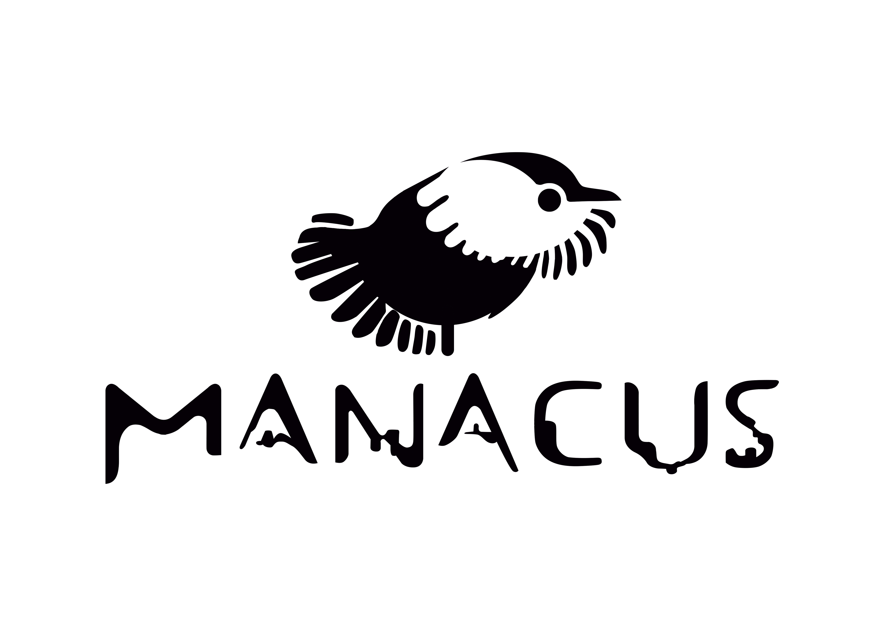
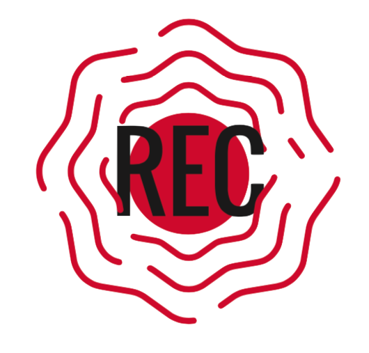

<html lang="es">
<head>
  <meta charset="UTF-8">
  <meta name="viewport" content="width=device-width, initial-scale=1">
  <meta name="google-site-verification" content="StWd0B-r52YYfce-ykcJZfxL-oWb9af7AhZ-_x0YrIo" />
  <title>Fundación Manacus</title>
  
</head>
<body>
  <header class="header-manacus">
    

      <nav class="header-nav">
        <!-- <a href="services/">Investigación</a> -->
        <a href="https://www.manacus.site/" target="_blank" rel="noopener">Visita nuestra página principal</a>
      </nav>
    

  </header>
  <!-- CONTENIDO PRINCIPAL SIGUIENTE -->
  

    

      
    

    

      
Fundación Manacus

      <h1 class="hero-title">Conservación basada en evidencia, tecnología y territorio</h1>
      

        <a class="hero-link" href="https://www.manacus.site/" target="_blank" rel="noopener">Visita nuestra página principal</a>
        <a class="hero-link" href="projects/puertoTriunfo/">Proyecto Puerto Triunfo</a>
      

    

      
Parte de la Red Ecoacústica Colombiana
        

  

  <footer class="footer-main">
  contacto@manacus.co | Cali, Valle del Cauca, Colombia | NIT: 901956753 | © 2025 Manacus
  </footer>
</body>
</html>

  

